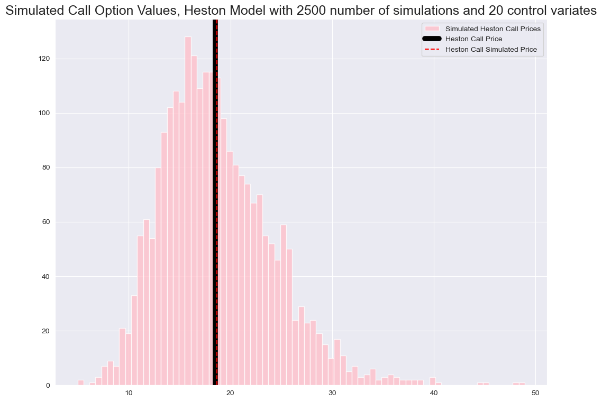

# Quantitative Finance Projects

Four self-contained projects in Python: portfolio construction, statistical
tests of standard modelling assumptions, option pricing, and hedging under
stochastic volatility. Each folder contains a notebook with the full analysis
and a README summarising its method and results.

  

*Monte Carlo call prices under the Heston model (2,500 paths, control variates), compared with the semi-analytic price from numerical integration.*

| # | Project | What it does | Key methods |
|:--|:--|:--|:--|
| 1 | [Portfolio optimization](01-portfolio-optimization) | Builds and compares low-risk and high-risk portfolios from three years of market data | Return, volatility and correlation estimates; constrained optimization with `scipy.optimize` |
| 2 | [Testing return normality](02-return-normality-tests) | Tests whether log returns of stocks, ETFs and portfolios are normally distributed, across time windows | D'Agostino–Pearson tests, QQ plots, volatility filtering |
| 3 | [Black–Scholes sensitivities](03-black-scholes-sensitivities) | Shows how European call and put prices respond to time to expiry and spot price | Black–Scholes pricing, numerical Greeks (Delta, Theta) |
| 4 | [Hedging under stochastic volatility](04-hedging-stochastic-volatility) | Compares delta-only and delta-vega hedging of an option book when volatility changes | Heston and stepwise-volatility path simulation, Monte Carlo pricing, P&L distributions, hedge frequency |

**Tools:** Python · NumPy · pandas · SciPy · Matplotlib/Seaborn · yfinance · Jupyter
